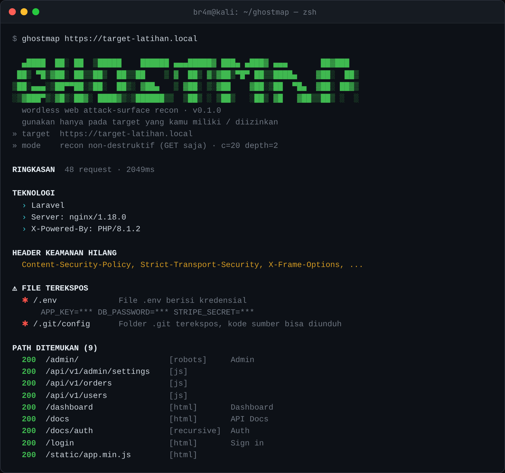

<div align="center">

# ghostmap

Memetakan halaman, endpoint, dan file tersembunyi sebuah situs **tanpa wordlist** — dengan membaca petunjuk yang situs itu bocorkan sendiri.



</div>

## Latar belakang

Waktu mulai belajar recon web, hal pertama yang semua orang suruh pakai adalah dir scanner seperti gobuster atau dirb. Cara kerjanya: kamu kasih wordlist berisi puluhan ribu nama (`admin`, `backup`, `old`, `test`, ...), lalu tool-nya menembak satu-satu ke server. Berisik, lama, dan hasilnya cuma sebagus wordlist-nya. Kalau endpoint aslinya namanya `/api/v1/invoices`, dan kata itu nggak ada di wordlist, ya nggak akan ketemu.

Padahal aplikasi web itu sering **menyebutkan rutenya sendiri** di tempat yang bisa dibaca siapa pun. File JavaScript di frontend isinya penuh `fetch("/api/v1/users")`. File `robots.txt` justru sering mencantumkan `/admin/` yang mau disembunyikan. Ada `sitemap.xml`, ada link di HTML. Daripada menebak, kenapa nggak dibaca aja?

ghostmap bekerja dari situ. Dia nggak punya wordlist sama sekali. Dia mengumpulkan path nyata dari sumber-sumber di atas, memeriksanya, lalu menelusuri halaman yang ketemu untuk menemukan lebih banyak. Hasilnya lebih relevan, lebih cepat, dan jauh lebih sedikit request dibanding brute force.

## Yang dilakukan

Dari satu URL, ghostmap mengumpulkan:

- **Path & endpoint** — diekstrak dari JavaScript, `robots.txt`, `sitemap.xml`, link halaman, lalu rekursif. Tiap temuan ditandai dari mana asalnya: `[js]`, `[robots]`, `[html]`, `[recursive]`.
- **File sensitif yang terbuka** — `.env`, `.git/config`, backup, `phpinfo.php`, `docker-compose.yml`, dan lainnya. Ditandai cuma kalau isinya benar-benar cocok, dan nilai yang mirip password atau API key **disensor** sebelum ditampilkan.
- **Teknologi** — ditebak dari header, cookie, dan isi halaman (Laravel, Next.js, WordPress, dsb).
- **Header keamanan yang hilang** — CSP, HSTS, X-Frame-Options, dan seterusnya.

Semua lewat request **GET** biasa. Nggak ada payload serangan, nggak ada yang ditulis atau diubah di server.

## Instalasi

**Unduh binary jadi** — paling gampang, nggak perlu install apa-apa. Ambil dari halaman [Releases](https://github.com/b3n3d1ck/ghostmap/releases), ekstrak, jalankan. Tersedia untuk Linux, Windows, dan macOS.

**Lewat Go** (butuh Go 1.21+):

```bash
go install github.com/b3n3d1ck/ghostmap@latest
```

**Build dari sumber:**

```bash
git clone https://github.com/b3n3d1ck/ghostmap.git
cd ghostmap
go build -o ghostmap .
```

Di WSL atau Ubuntu, kalau `go` belum ada: `sudo apt install -y golang-go`. Di Windows, hasilnya `ghostmap.exe`, jalankan dari cmd atau PowerShell.

## Pemakaian

```bash
ghostmap https://situs-punyamu.com                       # pemindaian standar
ghostmap -c 40 -depth 3 https://situs-punyamu.com         # lebih paralel, lebih dalam
ghostmap -rate 10 https://situs-punyamu.com               # batasi 10 request/detik
ghostmap -json -o hasil.json https://situs-punyamu.com    # simpan laporan JSON
```

| Opsi | Arti | Default |
|---|---|---|
| `-c` | request paralel | 20 |
| `-depth` | putaran rekursi untuk halaman yang di-crawl | 2 |
| `-rate` | batas request/detik (0 = tanpa batas) | 0 |
| `-max` | batas keras total request | 2000 |
| `-timeout` | timeout per request | 10s |
| `-json` / `-o` | keluaran JSON ke layar / ke file | — |
| `-insecure` | lewati verifikasi sertifikat TLS | off |
| `-ua` | ganti User-Agent | ghostmap/versi |

Keluaran JSON berguna kalau mau dilanjut ke tool lain, misalnya daftar endpoint-nya dilempar ke scanner kerentanan.

## Cara kerja

Urutannya kira-kira begini:

1. Ambil halaman utama, `robots.txt`, dan `sitemap.xml`.
2. Unduh file JavaScript yang dimuat halaman, lalu ekstrak path dan endpoint dengan regex (idenya mirip LinkFinder).
3. Susun semua kandidat path beserta prefix direktorinya, lalu periksa semuanya paralel.
4. Dari halaman HTML yang membalas 200, ambil link baru, ulangi sampai batas `-depth`.
5. Periksa daftar file sensitif. Sebelum itu, ghostmap meminta satu path acak dulu untuk tahu apakah server membalas 200 ke apa pun (soft-404), supaya nggak asal menandai.
6. Rangkum jadi laporan.

Request dibatasi oleh `-c` (paralelisme), `-rate` (kecepatan), dan `-max` (total), biar nggak membebani target.

## Batasan

Aku lebih suka jujur soal ini daripada melebih-lebihkan:

- ghostmap menemukan yang **direferensikan**. Endpoint yang benar-benar nggak disebut di mana pun nggak akan muncul. Itu memang trade-off-nya: menemukan yang begitu butuh brute force, dan brute force itu yang sengaja aku hindari.
- Fingerprint teknologinya berbasis pola sederhana, bisa meleset pada konfigurasi yang nggak biasa.
- Ini alat recon, bukan pemindai kerentanan. Dia menunjukkan permukaan serangan, bukan membuktikan ada celah yang bisa dieksploitasi.

## Izin & hukum

Pakai ghostmap **hanya pada sistem milikmu sendiri atau yang kamu punya izin tertulis** untuk menguji. Walaupun cuma mengirim GET dan memperkenalkan diri lewat User-Agent, memindai sistem orang lain tanpa izin tetap bisa melanggar hukum. Di Indonesia itu masuk UU ITE Pasal 30. Untuk latihan, pakai target yang memang disediakan: DVWA, OWASP Juice Shop, atau lab di HackTheBox / PortSwigger Academy.

## Kontribusi

Yang paling berguna: pola ekstraksi baru, tanda tangan file sensitif, atau deteksi teknologi. Tambahkan di kodenya, tambahkan tesnya (`go test ./...` harus lolos), lalu kirim pull request. Satu aturan: jangan menambahkan apa pun yang menyerang atau mengeksploitasi target. ghostmap sengaja dijaga tetap sebagai alat recon yang non-destruktif.

## Lisensi

[MIT](LICENSE) © 2025 Mas Bram
